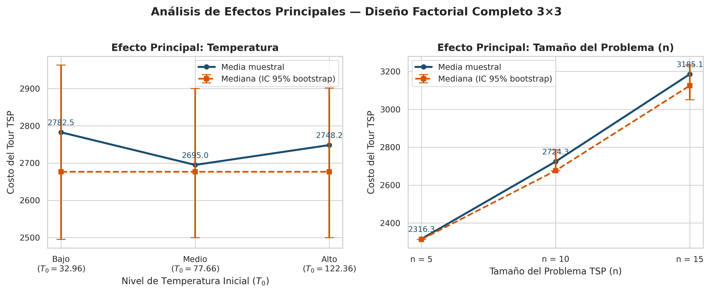
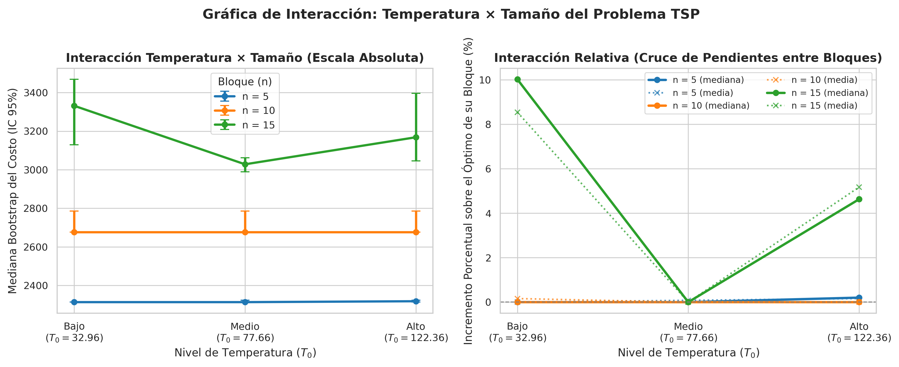
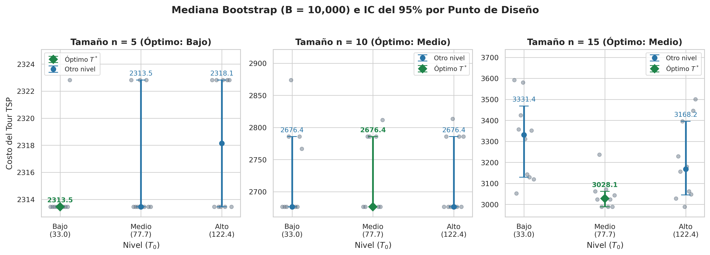

# Tarea 3 — Ajuste de Parámetros con Diseño de Experimentos (DOE)

**Repositorio oficial:** [https://github.com/Gomand06/Tarea3-AO](https://github.com/Gomand06/Tarea3-AO)  
**Matrícula:** `2225437`  
**Enfoque elegido:** Opción A — Diseño Factorial Completo ($3 \times 3$, $\alpha = 0.05$)

---

## Descripción del Problema y Diseño Experimental

Se ajustó el parámetro de **temperatura inicial ($T_0$)** del algoritmo de **Recocido Simulado (Simulated Annealing) con vecindario 2-opt** aplicado al Problema del Agente Viajero (TSP) Euclidiano 2D.

- **Factor:** Temperatura inicial $T_0$ en el rango $[T_{\min}, T_{\max}] = [1.0, 150.0]$.
- **Generación de niveles (Opción A):** Con semilla única igual a la matrícula (`random.seed(2225437)`), se obtuvo $r = 0.7148901388751733$:
  - **Bajo** ($0.3 \cdot r = 0.214467$): $T_0 = 32.9556$
  - **Medio** ($0.3 \cdot r + 0.3 = 0.514467$): $T_0 = 77.6556$
  - **Alto** ($0.3 \cdot r + 0.6 = 0.814467$): $T_0 = 122.3556$
- **Bloques:** Tamaño del problema TSP $n \in \{5, 10, 15\}$ (una instancia fija por tamaño con óptimo exacto Held-Karp conocido).
- **Réplicas:** 10 corridas independientes con semillas distintas por punto de diseño (**90 corridas totales**).
- **Esquema de enfriamiento:** Enfriamiento geométrico $\alpha = 0.88$, $18$ épocas con $n$ propuestas 2-opt por época ($\text{max\_iter} = 18n$).

---

## Estructura del Repositorio

```text
Tarea3-AO/
├── README.md
├── requirements.txt
├── data/
│   └── tsp_instances.json              # Instancias fijas TSP (n = 5, 10, 15) y óptimos Held-Karp
├── src/
│   ├── tsp_sa.py                       # TSP Euclidiano 2D, Held-Karp exacto y Recocido Simulado + 2-opt
│   ├── doe_experiment.py               # Ejecución de las 90 corridas (Opción A)
│   ├── stats_analysis.py               # ANOVA de dos factores (statsmodels) y Bootstrap (B = 10,000)
│   ├── plots.py                        # Gráficas de efectos principales, interacción e IC 95%
│   └── run_all.py                      # Script maestro para reproducir todo el experimento
├── results/
│   ├── experiment_config.json          # Metadatos y niveles exactos del experimento
│   ├── raw_runs.csv                    # Registro detallado de las 90 corridas
│   ├── anova_table.csv                 # Tabla ANOVA de dos factores (Tipo II)
│   ├── bootstrap_design_points.csv     # Estadísticas muestrales y bootstrap de los 9 puntos
│   └── optimal_parameters_summary.csv  # Tabla final con T* óptima por cada tamaño n
├── figures/                            # Gráficas en PDF y PNG
│   ├── main_effects.png / .pdf
│   ├── interaction.png / .pdf
│   └── bootstrap_intervals.png / .pdf
└── report/
    ├── reporte_tarea3.tex              # Código LaTeX listo para compilar en Overleaf o local
    └── figures/                        # Copia de figuras para compilación directa en Overleaf
```

---

## Reproducción

Instala las dependencias y ejecuta el flujo completo:

```bash
pip install -r requirements.txt
python src/run_all.py
```

---

## Resumen de Resultados

### Tabla ANOVA de Dos Factores ($\alpha = 0.05$)

| Fuente | Suma de Cuadrados | gl | $F$ | `PR(>F)` | Significativo |
| :--- | :---: | :---: | :---: | :---: | :---: |
| `C(temperatura)` | $116{,}698.07$ | 2 | $5.8979$ | $4.062 \times 10^{-3}$ | Sí |
| `C(tamano)` | $11{,}338{,}282.24$ | 2 | $573.0361$ | $1.565 \times 10^{-48}$ | Sí |
| `C(temperatura):C(tamano)` | $226{,}790.51$ | 4 | $5.7310$ | $4.109 \times 10^{-4}$ | Sí |
| `Residual` | $801{,}346.42$ | 81 | — | — | — |

### Parámetros Óptimos Seleccionados (Bootstrap $B = 10{,}000$, IC 95%)

| Tamaño ($n$) | Óptimo Exacto (Held-Karp) | Nivel Óptimo | Temperatura $T_0^*$ | Mediana Bootstrap | IC 95% Bootstrap |
| :---: | :---: | :---: | :---: | :---: | :---: |
| **5** | $2313.4535$ | **Bajo** | $32.9556$ | $2313.4535$ | $[2313.4535,\; 2313.4535]$ |
| **10** | $2676.4468$ | **Medio** | $77.6556$ | $2676.4468$ | $[2676.4468,\; 2785.7350]$ |
| **15** | $2988.6778$ | **Medio** | $77.6556$ | $3028.0827$ | $[2988.6778,\; 3061.9949]$ |

### Gráficas




